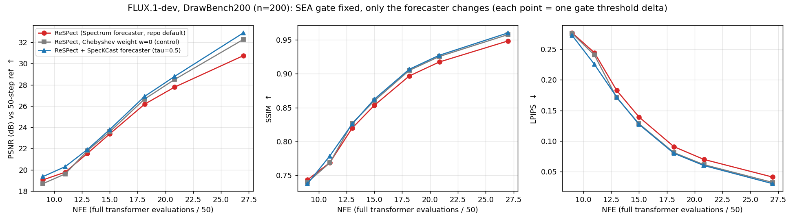
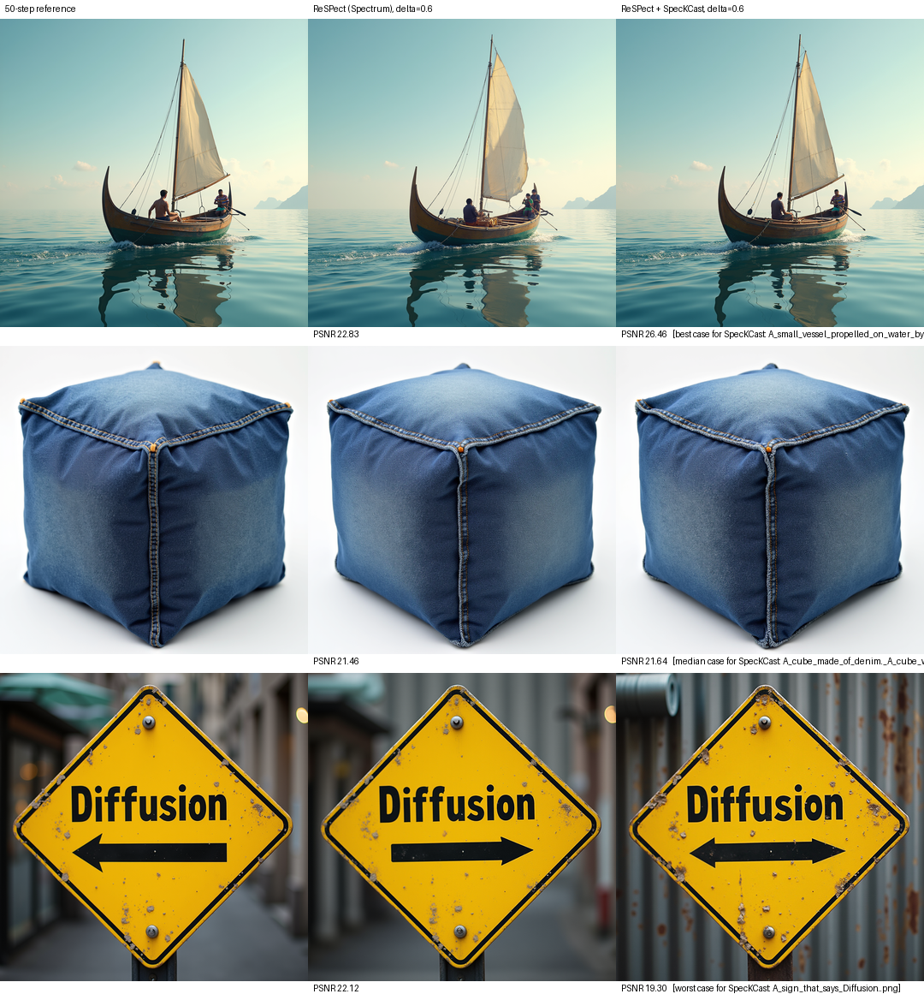

# KalSea for FLUX

KalSea inference for FLUX.1-dev / FLUX.1-schnell: SeaCache-style spectrally aligned gate (**when** to skip) plus a Kalman
residual forecaster (**what** to write on skipped steps). The previous ReSPect forecaster (Chebyshev + Taylor) is still
available as `--forecaster spectrum` for comparison.

## Installation

```bash
pip install --upgrade \
    "diffusers[torch]>=0.35" \
    transformers \
    protobuf \
    tokenizers \
    sentencepiece \
    accelerate \
    safetensors
```

Needs diffusers >= 0.35 (the patched forward uses the newer single-stream block signature). Tested with diffusers 0.41.0,
torch 2.14.1, transformers 5.20.2. FLUX.1-dev is gated on Hugging Face; accept the license and log in (`huggingface-cli login`).

## Usage

```bash
python kalsea_generate.py \
  --prompt "a high-resolution photo of a panda drinking coffee in a cozy cafe" \
  --output_dir ./outputs \
  --seacache_thresh 0.37
```

Multi-GPU (one process per GPU; seeds and file names do not depend on the sharding) and 50-step reference:

```bash
for i in 0 1 2 3 4 5 6 7; do
  CUDA_VISIBLE_DEVICES=$i python kalsea_generate.py --prompt_file my_prompts.txt --output_dir out \
      --seacache_thresh 0.37 --num_shards 8 --shard_id $i --quiet &
done; wait
python kalsea_generate.py --prompt_file my_prompts.txt --output_dir ref --no_cache     # 50 full steps
```

Every image also appends a line to `stats_shard<i>.jsonl` (latency, number of full evaluations, which steps were computed).

Arguments:
- `--prompt` / `--prompt_file`, `--output_dir`, `--width` / `--height` (default 1024), `--num_inference_steps` (default 50),
  `--guidance` (default 3.5), `--seed` (base seed; the prompt index is added)
- `--seacache_thresh`: gate threshold `δ`. FLUX.1-dev, 50 steps: `0.2` -> 27 full evaluations, `0.3` -> 21, `0.37` -> 18, `0.5` -> 15,
  `0.6` -> 13, `0.8` -> 11, `1.0` -> 9
- `--forecaster {kalsea,spectrum}` (default `kalsea`), `--no_cache`, `--num_shards` / `--shard_id`, `--quiet`

KalSea knobs (defaults are what was evaluated):
- `--kalsea_tau 0.5`: derivative damping time constant. The SpecKCast paper uses 0.1 for velocities; 0.5 is better for the
  smoother residual trajectories (broad plateau for 0.2 to 3).
- `--kalsea_calib` (default `kalsea_calib_flux.json`, or `none`), `--kalsea_time {warped,logsnr,step}`, `--kalsea_Tw 2.0`,
  `--kalsea_r_obs 1e-3`, `--kalsea_q_mult 1.0`, `--kalsea_no_adapt_q`
- `--kalsea_no_dct`: one Kalman filter per element instead of per DCT band. This is simpler, needs no calibration file
  (use `--kalsea_calib none --kalsea_time step`) and performed as well as the DCT version (see below).

Forecaster knobs of the ReSPect baseline: `--spectrum_m 4 --spectrum_k 100 --spectrum_lam 0.1 --spectrum_w 0.5 --spectrum_min_cheb_obs 4`.

## How it works
The gate is ReSPect's (unchanged): the first block's modulated input is SEA-filtered, its relative L1 change is accumulated,
and the step is skipped while the sum stays below `δ` (the first and last step are always computed). On a computed step the
residual `r = h_out - h_in` of the whole block stack is observed; on a skipped step the blocks are bypassed and
`h_in + forecast(r)` goes through `norm_out` / `proj_out`.

The forecaster tracks every element of `r` with a Kalman filter, state = (value, derivative), damped derivative
`nu <- exp(-ds/tau) nu`, predicted at **every** step and corrected only on computed steps, so the irregular gate schedule is
handled through the step size. In the default mode the 4096 image tokens of every channel are laid out on their 64x64 grid,
2D-DCT'd and split into 7 radial bands (band-shared covariance and a band-specific time coordinate from the noise schedule,
as in SpecKCast). `kalsea_calib_flux.json` holds the offline calibration of that mode (band powers and process noise, from 16
COCO trajectories); it is only used by the DCT / warped mode.

## Results (FLUX.1-dev, 50 steps, 1024x1024, DrawBench200, n=200, 8x B200)

Fidelity is measured against the 50-step image of the same seed (PSNR, SSIM with skimage defaults, LPIPS-Alex); reference
latency 5.27 s. Latency was measured with 8 concurrent single-GPU processes. The gate is identical for all rows, so the number
of full evaluations is the same; only the forecaster differs.

| gate δ | NFE | forecaster | latency (s) | PSNR ↑ | SSIM ↑ | LPIPS ↓ | extra mem (GiB) |
|---|---|---|---|---|---|---|---|
| 0.37 | 18.1 | ReSPect (Spectrum), repo default (`w=0.5`) | 2.161 | 26.18 | 0.8968 | 0.0908 | 0.47 |
| 0.37 | 18.1 | ReSPect (Spectrum), Chebyshev weight `w=0` (control) | 2.161 | 26.66 | 0.9049 | 0.0812 | 0.47 |
| 0.37 | 18.1 | KalSea, SpecKCast hyperparameters (`tau=0.1`) | 2.113 | 26.62 | 0.9024 | 0.0856 | 0.14 |
| 0.37 | 18.1 | **KalSea (`tau=0.5`)** | 2.114 | **26.91** | 0.9066 | 0.0801 | 0.14 |
| 0.37 | 18.1 | KalSea, no DCT (`tau=0.5`) | 2.104 | 26.87 | 0.9067 | 0.0799 | 0.14 |
| 0.6 | 13.0 | ReSPect (Spectrum), repo default (`w=0.5`) | 1.619 | 21.55 | 0.8196 | 0.1826 | 0.35 |
| 0.6 | 13.0 | ReSPect (Spectrum), Chebyshev weight `w=0` (control) | 1.619 | 21.80 | 0.8268 | 0.1708 | 0.35 |
| 0.6 | 13.0 | KalSea, SpecKCast hyperparameters (`tau=0.1`) | 1.585 | 21.74 | 0.8171 | 0.1860 | 0.14 |
| 0.6 | 13.0 | **KalSea (`tau=0.5`)** | 1.585 | **21.91** | 0.8256 | 0.1716 | 0.14 |
| 0.6 | 13.0 | KalSea, no DCT (`tau=0.5`) | 1.575 | 21.94 | 0.8292 | 0.1693 | 0.14 |

Paired difference KalSea (`tau=0.5`) minus ReSPect default over the 200 prompts (95% bootstrap CI):

| δ | PSNR | LPIPS |
|---|---|---|
| 0.37 | +0.72 dB [+0.45, +1.01] | -0.0108 [-0.0142, -0.0074] |
| 0.6 | +0.37 dB [+0.23, +0.51] | -0.0110 [-0.0152, -0.0071] |

<p align="center"></p>

Across the seven thresholds (δ = 0.2 ... 1.0) KalSea has higher PSNR (+0.3 to +2.1 dB) and lower LPIPS than the default ReSPect
forecaster at every one; SSIM is higher at six of them (slightly lower, 0.7376 vs 0.7433, at the most aggressive δ=1.0). CLIP-L
score and PickScore of the generated images are unchanged within noise. The gate leaves the compute schedule essentially
prompt independent, so NFE does not change with the forecaster.

<p align="center"></p>

Best, median and worst case (by PSNR gain of KalSea over ReSPect) at δ=0.6.

### How to read this
- **Most of the gain over the repo default is because the default Chebyshev term hurts here.** With `w=0` (linear extrapolation
  only) the Spectrum forecaster already gains about +0.5 dB at δ=0.37, and PSNR falls monotonically as `w` goes to 1. Against that
  stronger control KalSea's edge is small: +0.25 dB at δ=0.37 (CI [+0.13, +0.36]) and +0.11 dB at δ=0.6 (CI [-0.02, +0.25], not
  significant).
- **The spectral parts of the forecaster do not help in residual space.** The no-DCT variant matches or beats the DCT/band-warp
  version, and the band-specific time warp makes no measurable difference. The only truly spectral component is the SEA gate.
- `tau` and these ablations were chosen on 64 COCO prompts disjoint from DrawBench and from the 16 calibration prompts;
  the DrawBench numbers above are on unseen prompts.
- The calibration-free setting (`--kalsea_no_dct --kalsea_calib none --kalsea_time step`) uses the FLUX calibration values pooled
  over the bands as built-in defaults. On recorded FLUX residuals its forecast error equals that of the calibrated no-DCT filter
  (0.202 vs 0.204 at δ=0.37, 0.275 vs 0.279 at δ=0.6), but its generated-image quality was **not** evaluated.
- One model, one seed per prompt, fidelity w.r.t. the 50-step sample. The evaluation scripts are not part of this release.
- **Not bit-reproducible:** GPU kernels and atomic float adds make two runs of the same configuration differ slightly (39.8 dB
  PSNR between two runs on one image). This is far below the differences reported, but do not over-interpret differences
  smaller than about 0.1 dB.
