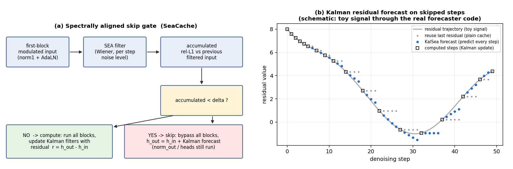

# KalSea: Kalman Residual Forecasting with Spectrally Aligned Skipping for Training-Free Acceleration of Diffusion Transformers

KalSea is a training-free cache for diffusion transformers. A spectrally aligned gate decides **when** to skip the
transformer blocks, a **Kalman residual forecaster** decides **what** to write on skipped steps, and **predictor-corrector
gap smoothing (PCGS)** corrects the skipped steps once the next computed step has been observed. PCGS adds no transformer
block evaluations.

<p align="center">
  
</p>
<p align="center">
  <b>Figure 1:</b> (a) Spectrally aligned skip gate (SeaCache). (b) Kalman forecast of the transformer residual on skipped
  steps (schematic: a toy signal run through the real forecaster code). PCGS is not drawn.
</p>

## Method
- **Gate (SeaCache's SEA gate).** At every step the modulated input of the first transformer block is passed through a
  spectral Wiener filter for the current noise level (SEA filter). Its relative L1 change since the last step is
  accumulated, and the blocks are skipped while the sum stays below the threshold `δ`. The first and last steps are always
  computed.
- **Forecaster (KalSea).** On a computed step the residual of the whole block stack, `r = h_out - h_in`, is observed. Kalman
  filters track it with the state (value, damped derivative). They are predicted at every step and corrected only on
  computed steps, so the irregular schedule of the gate enters through the step size. On a skipped step the blocks are
  bypassed and `h_in + forecast(r)` goes through the output layers. The forecaster is adapted from
  [SpecKCast](https://arxiv.org/abs/2610.26837).
- **PCGS (predictor-corrector gap smoothing).** When a computed step `b` ends a gap of skipped steps:
  1. The forecasts of the gap are smoothed with the innovation observed at `b`, using the Rauch-Tung-Striebel gains of the
     forecaster's own model.
  2. The sampler steps of the gap are re-integrated from the last exact latent with the smoothed residuals. Only the input
     embedding and the output layers run.
  3. Sampling continues from the corrected latent: the output at `b` is recomputed there with the residual observed at `b`,
     plus a velocity offset that moves the sampler onto the corrected latent. For Wan2.1 the UniPC multistep solver is
     replayed exactly instead (one replay per gap, conditional and unconditional streams kept separate).
  4. The gate's stored input is refreshed from the corrected latent.

| model | forecaster | gate | example `δ` |
|---|---|---|---|
| FLUX.1-dev | per-coefficient filters on 7 DCT bands of the token grid, warped time, `τ = 0.5`, `R = 1e-3` | SEA, β = 2 | 0.37 / 0.6 |
| HunyuanVideo | one filter per element, calibration-free, `τ = 0.5`, `R = 1e-3` | SEA, β = 3, live sampling noise level | 0.2575 / 0.48 |
| Wan2.1-T2V-1.3B | one filter per element and CFG stream, calibration-free, `τ = 0.5`, `R = 1e-3` | SEA, β = 3 | 0.2 / 0.35 |

## Supported models
#### Text-to-Image
- [FLUX](./FLUX/README.md): FLUX.1-dev with diffusers.

#### Text-to-Video
- [HunyuanVideo](./HunyuanVideo/README.md): drop-in for the official HunyuanVideo repository.
- [Wan2.1](./Wan2.1/README.md): drop-in for the official Wan2.1 repository (text-to-video).
- [MiniMax-H3](./MiniMax-H3/README.md): text-to-video with audio (`t2va`), gate and forecaster without PCGS. Its README
  describes its status.

## Practical notes
- **Training-free.** No extra weights. The transformer forward is patched; run the generate script of a backbone.
- **One threshold.** Sweep `δ` (`--delta`) for the speed-quality trade-off. A larger `δ` means fewer full evaluations.
- **Full transformer evaluations per generation (50 steps).** The gate is almost prompt independent:
  - FLUX.1-dev, 1024x1024: `δ` 0.2 -> 27, 0.3 -> 21, 0.37 -> 18, 0.5 -> 15, 0.6 -> 13, 0.8 -> 11, 1.0 -> 9.
  - HunyuanVideo, 480x640, 65 frames: 0.2575 -> 24, 0.48 -> 16.
  - Wan2.1-T2V-1.3B, 832x480, 65 frames: 0.2 -> 24, 0.35 -> 17 (each a conditional and an unconditional pass).
- **Switches** of the FLUX, HunyuanVideo and Wan2.1 scripts: KalSea with PCGS is the default. `--no_pcgs` runs the
  forecaster alone, `--reuse` runs SeaCache (the last residual is reused) and `--no_cache` computes every step.

## Layout
One folder per backbone with a generate script you run:

```
KalSea-v1/
  FLUX/kalsea_generate.py           FLUX.1 (diffusers)
  HunyuanVideo/kalsea_generate.py   copy the folder's .py files into the HunyuanVideo repository root
  Wan2.1/kalsea_generate.py         copy the folder's .py files into the Wan2.1 repository root
  MiniMax-H3/kalsea_generate.py     MiniMax-H3 (diffusers modular pipeline)
```

`kalsea_forecaster.py` (the Kalman forecaster) and `util_seacache.py` (the SEA filter) are copied into every folder, so
each folder is self-contained. This release contains inference code only.

## Usage
```bash
# FLUX.1-dev
cd FLUX
python kalsea_generate.py --prompt "a photo of an astronaut riding a horse" --output_dir out --delta 0.37

# HunyuanVideo (from the official repository root, after copying HunyuanVideo/*.py there)
python kalsea_generate.py --video-size 480 640 --video-length 65 --infer-steps 50 --flow-reverse --seed 42 \
    --prompt "A cat walks on the grass, realistic style." --save-path ./kalsea_results --delta 0.2575

# Wan2.1 (from the official repository root, after copying Wan2.1/*.py there)
python kalsea_generate.py --ckpt_dir ./Wan2.1-T2V-1.3B --prompt "A cat walks on the grass, realistic style." --delta 0.2
```

The README of each folder lists the options.

## Acknowledgement
Built on [SeaCache](https://github.com/jiwoogit/SeaCache) (gate), [SpecKCast](https://arxiv.org/abs/2610.26837)
(Kalman forecasting), [FLUX](https://github.com/black-forest-labs/flux), [HunyuanVideo](https://github.com/Tencent/HunyuanVideo),
[Wan2.1](https://github.com/Wan-Video/Wan2.1), [MiniMax-H3](https://huggingface.co/MiniMaxAI/MiniMax-H3) and
[Diffusers](https://github.com/huggingface/diffusers).
The implementation was written with the help of an AI coding assistant (Claude, run through the pi agent harness).
MiniMax-H3 weights are under the MiniMax-H3 Community License, which you must follow when using that backbone.

## Citation
```bibtex
@inproceedings{kalsea,
  title={KalSea: Kalman Residual Forecasting with Spectrally Aligned Skipping for Training-Free Acceleration of Diffusion Transformers}
}
```
